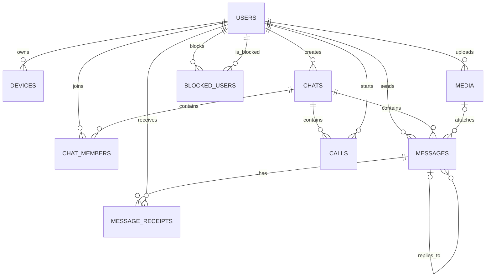

# Schema Design

## Design summary

The database is created in the `whatsapp` schema. Table and column names use lowercase `snake_case`, matching the CSV headers and the supplied workload queries. The schema contains only primary keys, foreign keys, unique constraints, `NOT NULL`, defaults for common booleans, and `CHECK` constraints. No manual performance indexes are created in this phase.

User deletion is handled as soft deletion by setting `users.status = 'DELETED'`. User foreign keys therefore use `ON DELETE RESTRICT` so that a physical delete cannot remove historical identity references. Child rows owned by a chat use `ON DELETE CASCADE`; optional message references use `ON DELETE SET NULL`.

## Data dictionary

### `users`

| Column | Type | Constraint | Reason |
|---|---|---|---|
| `user_id` | `INTEGER` | Primary key | Stable account identifier. |
| `phone_e164` | `VARCHAR(13)` | `NOT NULL`, `UNIQUE`, Indian E.164 `CHECK` | Account lookup key; `+91` plus ten digits. |
| `display_name` | `TEXT` | `NOT NULL` | User-visible name; no arbitrary seed-derived limit. |
| `about` | `TEXT` | Nullable | The export contains missing about text. |
| `is_business` | `BOOLEAN` | `NOT NULL`, default `FALSE` | Business-account flag. |
| `joined_on` | `DATE` | `NOT NULL` | Registration date. |
| `last_seen_at` | `TIMESTAMPTZ` | Nullable | Offline or unavailable users have no last-seen value. |
| `status` | `user_status` | `NOT NULL`, default `ACTIVE` | Supports active, banned, and soft-deleted accounts. |

### `devices`

| Column | Type | Constraint | Reason |
|---|---|---|---|
| `device_id` | `INTEGER` | Primary key | Device identifier. |
| `user_id` | `INTEGER` | `NOT NULL`, FK to `users` | Every exported device belongs to a user. |
| `device_type` | `device_type` | `NOT NULL` | Android, desktop, web, or iOS. |
| `app_version` | `TEXT` | `NOT NULL`, version-format `CHECK` | Versions can grow beyond the current seven-character examples. |
| `registered_at` | `TIMESTAMPTZ` | `NOT NULL` | Registration timestamp. |
| `last_active_at` | `TIMESTAMPTZ` | `NOT NULL`, `>= registered_at` | Prevents impossible activity times. |

### `chats`

| Column | Type | Constraint | Reason |
|---|---|---|---|
| `chat_id` | `INTEGER` | Primary key | Chat identifier. |
| `chat_type` | `chat_type` | `NOT NULL` | Direct or group chat. |
| `group_name` | `TEXT` | Nullable, type-dependent `CHECK` | Direct chats have `NULL`; groups require a name. |
| `created_by` | `INTEGER` | `NOT NULL`, FK to `users` | Records the creator while preserving that ID. |
| `created_at` | `TIMESTAMPTZ` | `NOT NULL` | Chat creation timestamp. |

### `chat_members`

| Column | Type | Constraint | Reason |
|---|---|---|---|
| `chat_id` | `INTEGER` | Part of composite PK, FK to `chats` | Membership relationship. |
| `user_id` | `INTEGER` | Part of composite PK, FK to `users` | Prevents duplicate membership rows for one user and chat. |
| `role` | `member_role` | `NOT NULL` | Member or admin. |
| `joined_at` | `TIMESTAMPTZ` | `NOT NULL` | Membership start. |
| `left_at` | `TIMESTAMPTZ` | Nullable, `>= joined_at` | Active members have no leave time. |
| `is_muted` | `BOOLEAN` | `NOT NULL`, default `FALSE` | Per-user chat notification setting. |

### `media`

| Column | Type | Constraint | Reason |
|---|---|---|---|
| `media_id` | `INTEGER` | Primary key | Media identifier. |
| `uploader_id` | `INTEGER` | `NOT NULL`, FK to `users` | Retains the uploader identity. |
| `media_type` | `media_type` | `NOT NULL` | Image, audio, document, or video. |
| `mime_type` | `mime_type` | `NOT NULL`, mapped by `CHECK` | Restricts each media type to its supplied MIME type. |
| `size_bytes` | `BIGINT` | `NOT NULL`, `> 0` | File size can exceed the `INTEGER` range. |
| `sha256` | `CHAR(64)` | `NOT NULL`, hexadecimal `CHECK` | Export stores the 64-character SHA-256 representation. |
| `uploaded_at` | `TIMESTAMPTZ` | `NOT NULL` | Upload timestamp. |

### `blocked_users`

| Column | Type | Constraint | Reason |
|---|---|---|---|
| `blocker_id` | `INTEGER` | Part of composite PK, FK to `users` | User who created the block. |
| `blocked_id` | `INTEGER` | Part of composite PK, FK to `users` | User being blocked. |
| `blocked_at` | `TIMESTAMPTZ` | `NOT NULL` | Block timestamp. |

The composite primary key is required because one blocker can block multiple users and one user can be blocked by multiple users.

### `calls`

| Column | Type | Constraint | Reason |
|---|---|---|---|
| `call_id` | `INTEGER` | Primary key | Call identifier. |
| `chat_id` | `INTEGER` | `NOT NULL`, FK to `chats` | Chat in which the call occurred. |
| `caller_id` | `INTEGER` | `NOT NULL`, FK to `users` | Caller identity. |
| `call_type` | `call_type` | `NOT NULL` | Voice or video. |
| `started_at` | `TIMESTAMPTZ` | `NOT NULL` | Start time. |
| `answered_at` | `TIMESTAMPTZ` | Nullable | Missing for unanswered calls. |
| `ended_at` | `TIMESTAMPTZ` | Nullable | Missing for failed calls. |
| `status` | `call_status` | `NOT NULL`, timestamp `CHECK` | Keeps status and timestamps consistent. |

### `messages`

| Column | Type | Constraint | Reason |
|---|---|---|---|
| `message_id` | `INTEGER` | Primary key | Message identifier. |
| `chat_id` | `INTEGER` | `NOT NULL`, FK to `chats` | Destination chat. |
| `sender_id` | `INTEGER` | `NOT NULL`, FK to `users` | Sender identity remains available after soft deletion. |
| `sent_at` | `TIMESTAMPTZ` | `NOT NULL` | Send timestamp. |
| `message_type` | `message_type` | `NOT NULL` | Includes text, location, and media-backed types. |
| `body` | `TEXT` | Nullable | Empty for many media messages and possibly deleted content. |
| `media_id` | `INTEGER` | Nullable, FK to `media` | Only some messages reference media. |
| `reply_to_message_id` | `INTEGER` | Nullable, self-FK | Optional reply chain. |
| `is_forwarded` | `BOOLEAN` | `NOT NULL`, default `FALSE` | Forwarding flag. |
| `is_deleted` | `BOOLEAN` | `NOT NULL`, default `FALSE` | Delete-for-everyone state. |
| `edited_at` | `TIMESTAMPTZ` | Nullable, `>= sent_at` | Only edited messages have an edit time. |

When `media_id` is present, `message_type` and the referenced `media.media_type` should match. This is a cross-table integrity check rather than a simple row-level `CHECK`; the seed contains some media-typed messages with no `media_id`, so the schema does not incorrectly require media for every such message.

### `message_receipts`

| Column | Type | Constraint | Reason |
|---|---|---|---|
| `message_id` | `INTEGER` | Part of composite PK, FK to `messages` | One receipt per message and recipient. |
| `user_id` | `INTEGER` | Part of composite PK, FK to `users` | Recipient identity. |
| `delivered_at` | `TIMESTAMPTZ` | Nullable | Undelivered receipts have no delivery time. |
| `read_at` | `TIMESTAMPTZ` | Nullable, after delivery | Read time cannot precede delivery. |

## Entity relationships



Cardinalities:

- `users` to `devices`, `messages`, `media`, and `calls` are one-to-many.
- `users` and `chats` are many-to-many through `chat_members`.
- `messages` and `users` are many-to-many through `message_receipts`.
- `messages` has a recursive one-to-many reply relationship.
- `blocked_users` is a directed many-to-many relationship from users to users.

## Functional dependencies and normal form

| Table | Main functional dependencies | Normal form |
|---|---|---|
| `users` | `user_id -> phone_e164, display_name, about, is_business, joined_on, last_seen_at, status`; `phone_e164 -> user_id, ...` | BCNF, assuming phone numbers are unique account identifiers. |
| `devices` | `device_id -> user_id, device_type, app_version, registered_at, last_active_at` | BCNF. |
| `chats` | `chat_id -> chat_type, group_name, created_by, created_at` | BCNF. |
| `chat_members` | `(chat_id, user_id) -> role, joined_at, left_at, is_muted` | BCNF. |
| `media` | `media_id -> uploader_id, media_type, mime_type, size_bytes, sha256, uploaded_at` | BCNF. |
| `blocked_users` | `(blocker_id, blocked_id) -> blocked_at` | BCNF. |
| `calls` | `call_id -> chat_id, caller_id, call_type, started_at, answered_at, ended_at, status` | BCNF. |
| `messages` | `message_id -> chat_id, sender_id, sent_at, message_type, body, media_id, reply_to_message_id, is_forwarded, is_deleted, edited_at` | BCNF. |
| `message_receipts` | `(message_id, user_id) -> delivered_at, read_at` | BCNF. |

The schema stores facts rather than derived aggregates. Member counts, unread counts, call duration, daily active users, and message totals are computed by queries. `media.media_type` describes the stored file, while `messages.message_type` describes the message, so they are not globally redundant even though referenced values should agree.

## Seed-data validation

The supplied exports contain the following rows:

| File/table | Rows |
|---|---:|
| `users` | 30,000 |
| `devices` | 42,000 |
| `chats` | 23,000 |
| `chat_members` | 104,514 |
| `media` | 27,634 |
| `messages` | 120,000 |
| `message_receipts` | 501,590 |
| `calls` | 25,000 |
| `blocked_users` | 4,000 |

The following checks were performed against the seed exports and should be run after loading as SQL integrity checks:

### 1. Every message sender belongs to the chat

```sql
SELECT COUNT(*) AS violations
FROM messages m
WHERE NOT EXISTS (
    SELECT 1
    FROM chat_members cm
    WHERE cm.chat_id = m.chat_id
      AND cm.user_id = m.sender_id
);
```

Result: `0` violations.

### 2. Every reply belongs to the same chat

```sql
SELECT COUNT(*) AS violations
FROM messages m
JOIN messages parent
  ON parent.message_id = m.reply_to_message_id
WHERE parent.chat_id <> m.chat_id;
```

Result: `0` violations.

### 3. Every direct chat has exactly two members

```sql
SELECT COUNT(*) AS violations
FROM chats c
LEFT JOIN chat_members cm ON cm.chat_id = c.chat_id
WHERE c.chat_type = 'DIRECT'
GROUP BY c.chat_id
HAVING COUNT(cm.user_id) <> 2;
```

Result: `0` violating chats; all 20,000 direct chats have two members.

### 4. Receipt recipients belong to the message chat

```sql
SELECT COUNT(*) AS violations
FROM message_receipts r
JOIN messages m ON m.message_id = r.message_id
WHERE NOT EXISTS (
    SELECT 1
    FROM chat_members cm
    WHERE cm.chat_id = m.chat_id
      AND cm.user_id = r.user_id
);
```

Result: `0` violations.

### 5. Referenced media matches the message type

```sql
SELECT COUNT(*) AS violations
FROM messages m
JOIN media me ON me.media_id = m.media_id
WHERE m.message_type::TEXT <> me.media_type::TEXT;
```

Result: `0` violations.

## Automatically created indexes

No manual indexes are created in `01_schema.sql`. PostgreSQL automatically creates indexes for:

- The primary key of each table.
- The unique constraint on `users.phone_e164`.

Additional indexes belong in `sql/05_indexes.sql` after baseline timings are collected.
